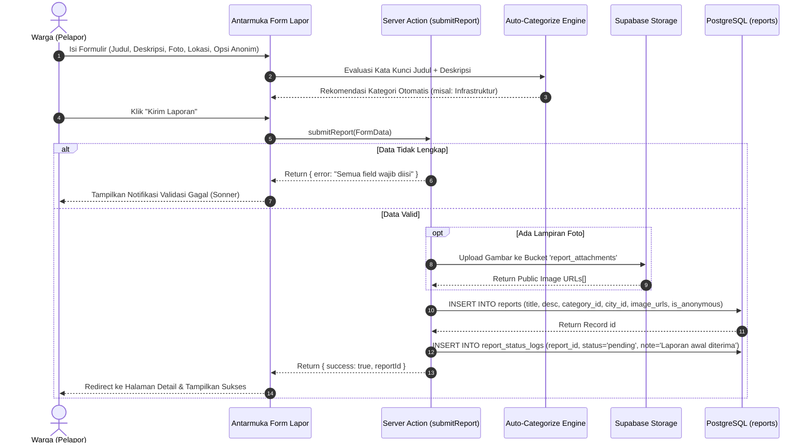
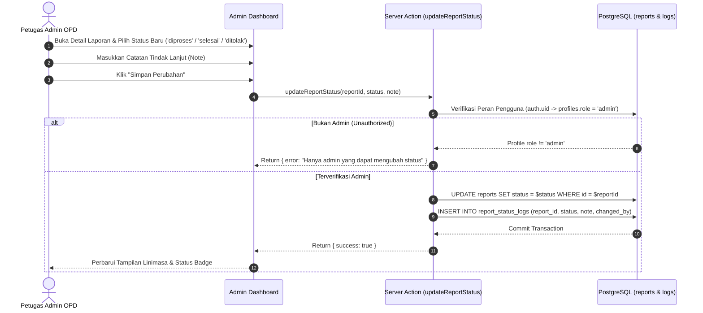
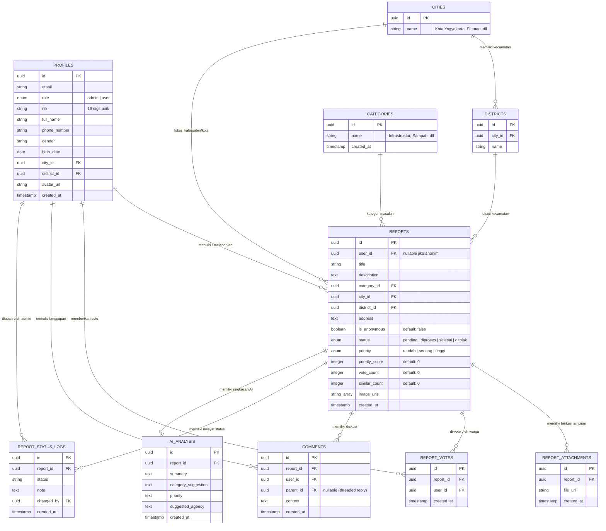

# Technical Specifications Document (TSD) — Laporin Aja Bro

> **Dokumen Kontrol:**
> * **Nama Proyek:** Laporin Aja Bro (Platform Pelaporan Fasilitas & Layanan Publik DIY)
> * **Penulis / Pengembang:** Muhammad Ilham Setiawan
> * **Versi Dokumen:** v1.0
> * **Status Implementasi:** Selesai & Terimplementasi di Production
> * **URL Produksi:** [https://laporin-aja-bro.vercel.app](https://laporin-aja-bro.vercel.app)
> * **Target Lingkungan:** Vercel Edge/Serverless (Next.js 16) + Supabase (PostgreSQL 15+, Auth, Storage, RLS)

---

## 1. Arsitektur Sistem Tingkat Tinggi (*High-Level Architecture*)

Sistem dibangun menggunakan **Next.js 16 App Router** dengan pendekatan **Clean Layered Architecture** yang memisahkan tanggung jawab antara *Presentation Layer*, *Business Logic/Service Layer*, dan *Data Access/Repository Layer*:

```
┌─────────────────────────────────────────────────────────────────────────┐
│                       PRESENTATION LAYER (UI / UX)                      │
│   Next.js App Router Pages, React 19 Client Components, Tailwind CSS v4 │
│   (Explore Feed, Create Report Form, Report Detail, Admin Dashboard)   │
└────────────────────────────────────┬────────────────────────────────────┘
                                     │ Invokes
                                     ▼
┌─────────────────────────────────────────────────────────────────────────┐
│                    APPLICATION & BUSINESS LOGIC LAYER                   │
│   Next.js Server Actions (lib/actions/*) & Domain Services (lib/services/*)│
│   • reportService  • voteService  • commentService  • statusLogService  │
│   • Auto-Categorization Rule Engine  • Priority Scoring Math            │
└────────────────────────────────────┬────────────────────────────────────┘
                                     │ Queries
                                     ▼
┌─────────────────────────────────────────────────────────────────────────┐
│                      DATA ACCESS & REPOSITORY LAYER                     │
│   Repository Layer (lib/repositories/*) & Supabase SSR Client (@supabase/ssr)│
│   • reportRepository • locationRepository • commentRepository • voteRepo│
└────────────────────────────────────┬────────────────────────────────────┘
                                     │ Database / Auth / Storage
                                     ▼
┌─────────────────────────────────────────────────────────────────────────┐
│                         SUPABASE CLOUD PLATFORM                         │
│   • PostgreSQL Database with Row Level Security (RLS)                   │
│   • Supabase GoTrue Auth (Session Cookies & JWT)                        │
│   • Supabase Storage (Bucket: report_attachments, avatars)              │
│   • Supabase Realtime Engine (Pub/Sub replication)                      │
└─────────────────────────────────────────────────────────────────────────┘
```

---

## 2. Diagram Alur Aktivitas (*UML Activity Diagrams*)

### 2.1 Alur Pembuatan Laporan Aduan Warga (*Citizen Report Submission Flow*)



---

### 2.2 Alur Moderasi & Pembaruan Status oleh Admin (*Admin Moderation Flow*)



---

## 3. Diagram Relasi Entitas (*Entity Relationship Diagram — Crow's Foot*)



---

## 4. Spesifikasi Kamus Data (*Database Data Dictionary*)

### 4.1 Tabel Utama `reports`

| Kolom | Tipe Data | Constraint | Keterangan Bisnis |
| :--- | :--- | :--- | :--- |
| `id` | `UUID` | `PRIMARY KEY, DEFAULT uuid_generate_v4()` | Kunci primer unik laporan |
| `user_id` | `UUID` | `REFERENCES profiles(id) ON DELETE SET NULL` | ID akun pelapor (disamarkan jika anonim) |
| `title` | `TEXT` | `NOT NULL` | Judul ringkas masalah |
| `description` | `TEXT` | `NOT NULL` | Rincian kronologi dan detail aduan |
| `category_id` | `UUID` | `REFERENCES categories(id) NOT NULL` | Kategori aduan (9 kategori resmi) |
| `city_id` | `UUID` | `REFERENCES cities(id) NOT NULL` | Kota / Kabupaten di wilayah DIY |
| `district_id` | `UUID` | `REFERENCES districts(id), Nullable` | Kecamatan lokasi kejadian |
| `address` | `TEXT` | `Nullable` | Alamat patokan spesifik lokasi |
| `is_anonymous` | `BOOLEAN` | `DEFAULT false` | True = Nama & profil disembunyikan di publik |
| `status` | `ENUM` | `DEFAULT 'pending'` | Nilai: `pending`, `diproses`, `selesai`, `ditolak` |
| `priority` | `ENUM` | `DEFAULT 'rendah'` | Nilai: `rendah`, `sedang`, `tinggi` |
| `priority_score`| `INTEGER`| `DEFAULT 0` | Skor kalkulasi bobot urgensi |
| `vote_count` | `INTEGER` | `DEFAULT 0` | Akumulasi jumlah dukungan warga |
| `similar_count`| `INTEGER` | `DEFAULT 0` | Jumlah laporan serupa yang terdeteksi |
| `image_urls` | `TEXT[]` | `DEFAULT '{}'` | Daftar URL publik foto di Supabase Storage |
| `created_at` | `TIMESTAMP`| `DEFAULT now()` | Waktu pembuatan laporan |

---

## 5. Algoritma & Logika Bisnis

### 5.1 Algoritma *Rule-Based Auto-Categorization*
Sistem menganalisis teks `title` dan `description` laporan secara otomatis untuk mendeteksi kategori yang relevan:

```typescript
// Cuplikan Logika di lib/utils/autoCategorize.ts
const CATEGORY_RULES = [
  { keywords: ["jalan", "lubang", "aspal", "trotoar", "jembatan"], category: "Infrastruktur & Jalan" },
  { keywords: ["lampu", "penerangan", "pju", "gelap", "bohlam"], category: "Penerangan Jalan" },
  { keywords: ["sampah", "bau", "limbah", "tps", "kotor", "sungai"], category: "Sampah & Lingkungan" },
  { keywords: ["pungli", "suap", "parkir liar", "tarif"], category: "Pungli & Gratifikasi" },
  { keywords: ["balap liar", "tawuran", "maling", "begal", "klitih"], category: "Keamanan & Kriminal" },
  { keywords: ["puskesmas", "rsud", "obat", "ambulans"], category: "Kesehatan" },
  { keywords: ["ktp", "kk", "kelurahan", "pelayanan", "antrean"], category: "Pelayanan Publik" },
  { keywords: ["sekolah", "gedung", "ruang kelas", "bangku"], category: "Fasilitas Pendidikan" },
];
```

### 5.2 Algoritma Kalkulasi Skor Prioritas (*Priority Scoring Engine*)
```typescript
priority_score = vote_count + (similar_count * 2);

if (priority_score >= 15) {
  priority = "tinggi";
} else if (priority_score >= 6) {
  priority = "sedang";
} else {
  priority = "rendah";
}
```

---

## 6. Spesifikasi Kontrak REST API & Postman Collection

Seluruh endpoint REST API di bawah ini dibundel dalam berkas resmi:
📁 **[`docs/Laporin Aja Bro.postman_collection.json`](file:///e:/project-nextjs/laporin-aja-bro/docs/Laporin%20Aja%20Bro.postman_collection.json)**

| Modul | Method | Endpoint | Keterangan | Autentikasi |
| :--- | :--- | :--- | :--- | :--- |
| **Auth** | `POST` | `/api/auth/login` | Masuk ke akun menggunakan Email & Password | Publik |
| **Auth** | `POST` | `/api/auth/register` | Registrasi akun baru lengkap dengan validasi 16-digit NIK | Publik |
| **Auth** | `GET` | `/api/auth/me` | Mengambil data profil pengguna yang sedang login | Bearer / Cookie |
| **Auth** | `POST` | `/api/auth/logout` | Mengakhiri sesi aktif dan membersihkan cookie | Terautentikasi |
| **Master**| `GET` | `/api/master/categories` | Mengambil daftar 9 kategori masalah resmi | Publik |
| **Master**| `GET` | `/api/master/cities` | Mengambil 5 Kota/Kabupaten di wilayah DIY | Publik |
| **Master**| `GET` | `/api/master/districts?city_id=...` | Mengambil daftar kecamatan berdasarkan kota | Publik |
| **Reports**| `GET` | `/api/reports?city=...&status=...` | Mengambil feed publik aduan warga dengan filter | Publik |
| **Reports**| `POST` | `/api/reports` | Membuat dan mempublikasikan aduan baru | Publik / User |
| **Reports**| `GET` | `/api/reports/:id` | Mengambil rincian aduan, foto, log, dan komentar | Publik |
| **Reports**| `POST` | `/api/reports/:id/vote` | Memberikan / membatalkan *upvote* urgensi aduan | Terautentikasi |
| **Reports**| `POST` | `/api/reports/:id/comments` | Menambahkan komentar / tanggapan diskusi | Terautentikasi |
| **Admin** | `PATCH`| `/api/reports/:id/status` | Memperbarui status aduan (`diproses`/`selesai`/`ditolak`) | Khusus Admin |

---

## 7. Keamanan Data & Row Level Security (RLS)

* **Keamanan Akses Tabel `profiles`:** Pengguna biasa hanya diizinkan membaca profil milik sendiri (`auth.uid() = id`), sedangkan admin memiliki hak supervisi.
* **Keamanan Akses Tabel `reports`:** Publik dapat membaca seluruh laporan publik (`SELECT true`) dan mengirimkan aduan (`INSERT true`), namun operasi mutasi `UPDATE status` dikunci secara ketat di level PostgreSQL RLS hanya untuk `role = 'admin'`.
* **Keamanan Storage Bucket `report_attachments`:** Mencegah file berbahaya dengan membatasi *MIME Types* ke format gambar (`image/jpeg`, `image/png`, `image/webp`) dan kuota maksimal 5MB per berkas.
